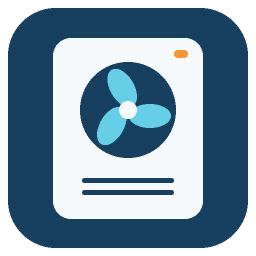

# Aquarea Service Cloud Read Only



**Autor i opiekun: Krzysztof Domański — [@python-kdomanski](https://github.com/python-kdomanski)**

Integracja Home Assistant do monitorowania pomp Panasonic Aquarea przez **Aquarea Service Cloud**.
Udostępnia wyłącznie sensory. Łączy się bezpośrednio przez HTTPS; nie wymaga MQTT,
Mosquitto, programu Go ani dodatkowej elektroniki.

[](https://www.hacs.xyz/docs/faq/custom_repositories/)
[](https://github.com/python-kdomanski/ha-aquarea-service-cloud-readonly/actions/workflows/validate.yaml)

## Wymagania

- Home Assistant **2026.10.0 lub nowszy** i HACS.
- Konto **Aquarea Service Cloud**, z dostępem do odczytu wybranej pompy.
- Połączenie Home Assistant z internetem.

Dane konta Service Cloud mogą być inne niż w Comfort Cloud / Smart Cloud.
Najpierw sprawdź dostęp do swojej pompy w [Aquarea Service Cloud](https://aquarea-service.panasonic.com/).

## Instalacja przez HACS

1. W HACS otwórz menu **⋮ → Repozytoria niestandardowe**.
2. Dodaj adres:
   `https://github.com/python-kdomanski/ha-aquarea-service-cloud-readonly`
3. Wybierz kategorię **Integracja** i zatwierdź.
4. Odszukaj **Aquarea Service Cloud Read Only** i pobierz najnowszą wersję.
5. Uruchom ponownie **Home Assistant**.
6. Przejdź do **Ustawienia → Urządzenia i usługi → Dodaj integrację**.
7. Wybierz **Aquarea Service Cloud Read Only**, podaj dane Service Cloud i wybierz pompę.

Po konfiguracji urządzenie i jego sensory pojawią się w HA. Integracja nie tworzy automatycznie
pulpitu. [Przykładowa karta monitoringu](examples/monitoring.yaml) wymaga dopasowania identyfikatorów encji.

Repozytorium dodaje się ręcznie do HACS; nie jest częścią domyślnego katalogu HACS.

## Przejście z wersji skopiowanej ręcznie

Jeśli integracja już działa z katalogu `custom_components/aquarea_service_cloud_ro`:

1. Zachowaj kopię zapasową konfiguracji HA.
2. Dodaj to repozytorium do HACS i pobierz integrację.
3. Uruchom ponownie HA.

Pozostaw istniejący wpis integracji. Domena, klucze i unikalne identyfikatory sensorów zostały
zachowane, więc dotychczasowe encje i konfiguracja powinny pozostać dostępne.
Jeśli HACS zgłosi, że katalog istnieje, wybierz oferowaną przez HACS opcję ponownego pobrania.
Nie usuwaj konfiguracji integracji, żeby rozwiązać sam konflikt plików.

## Dostępne odczyty

Integracja tworzy **33 encje sensorów**:

- **30 sensorów statusu**, m.in. temperatury, przepływ wody, prędkość pompy obiegowej,
  częstotliwość sprężarki, tryb pracy i liczniki. Odczyt co **60 sekund**.
- **3 sensory historii**, odczytywane co **5 minut**:

| Parametr historii | Nazwa encji | Jednostka |
| --- | --- | --- |
| 63 | Prąd zewnętrzny | A |
| 72 | Pobór mocy w trybie grzania | kW |
| 78 | Pobór mocy w trybie CWU | kW |

Numery parametrów historii potwierdzono na żądaniach wykresów konkretnej pompy.
Dla innych generacji urządzeń mapowanie wymaga sprawdzenia.

### Czas pomiaru historii

Nowe sensory prezentują **ostatnią dostępną próbkę historyczną**. W przesłanych danych
Panasonic zapisywał kolejne próbki co 5 minut. Atrybut `czas_pomiaru` zawiera znacznik
czasu w UTC (ISO 8601); nie jest to czas pobrania danych przez HA.

- Zero jest poprawnym odczytem.
- Próbka starsza niż **20 minut** powoduje niedostępność danego sensora historii.
- Błąd historii nie blokuje odczytu dotychczasowych sensorów statusu.
- Moc w kW nie jest licznikiem energii w kWh.
- Pomiary grzania i CWU dotyczą określonych trybów; nie należy zakładać, że obejmują
  wszystkie odbiorniki elektryczne instalacji.

### Brakujące wartości

Pompa może nie udostępniać danych o opcjonalnym wyposażeniu, np. buforze, solarach lub drugiej strefie.
Takie sensory mogą mieć stan „nieznany”. Wartość `-` w obecnym parserze statusu jest
traktowana jako brak odczytu, także dla pola błędu.

## Hasło i bezpieczeństwo

- Login i hasło wprowadza się w formularzu HA; nie wpisuje się ich do kodu repozytorium.
- HA przechowuje je w danych wpisu integracji, aby umożliwić ponowne logowanie.
  Integracja nie dodaje własnego szyfrowania tego magazynu.
- Sesje i tokeny są utrzymywane w pamięci klienta. Komunikacja HTTPS weryfikuje certyfikaty.
- Integracja nie zapisuje haseł ani wartości tokenów w swoich logach.
- Brak encji sterujących, usług ustawiających parametry i endpointów zmieniających pracę pompy.
- Chroń dostęp administratora HA oraz kopie zapasowe, ponieważ mogą zawierać dane logowania.

To niezależny projekt społecznościowy korzystający z nieudokumentowanego protokołu Panasonic.
Zmiany po stronie Service Cloud mogą wymagać aktualizacji integracji.

## Aktualizacje i usuwanie

HACS informuje o kolejnych wydaniach. Po pobraniu aktualizacji uruchom ponownie HA.
Aby usunąć integrację, usuń jej wpis w **Ustawienia → Urządzenia i usługi**, następnie usuń pakiet
w HACS i uruchom ponownie HA.

## Diagnostyka

W **Ustawienia → System → Dzienniki** wyszukaj `aquarea_service_cloud_ro`.
W zgłoszeniu podaj wersję HA, wersję integracji i kod błędu. Usuń z niego dane osobowe,
identyfikatory urządzenia i dane sesji. Nie dołączaj hasła, plików `.storage`,
nagłówków uwierzytelnienia ani pełnego pliku HAR.

Problemy można zgłaszać w [Issues](https://github.com/python-kdomanski/ha-aquarea-service-cloud-readonly/issues).

## Sprawdzenie projektu

Z katalogu repozytorium:

```console
python -m unittest discover -s tests -p "test_*.py" -v
python scripts/validate_package.py
```

Lokalne testy nie łączą się z Panasonic ani nie wymagają hasła. Sprawdzają protokół na
przykładowych odpowiedziach i tworzenie encji na minimalnych interfejsach HA.
GitHub Actions dodatkowo uruchamia walidację **HACS** oraz **hassfest**.

Podstawowe 30 sensorów potwierdzono w rzeczywistym HA. Rozszerzenie historii przeszło
testy lokalne i parsowanie dostarczonych próbek; odczyty trzech nowych encji wymagają
potwierdzenia po restarcie HA. Szczegóły wydań: [CHANGELOG.md](CHANGELOG.md).

## Autor, źródła i licencja

**Krzysztof Domański** — [AUTHORS.md](AUTHORS.md). Licencja [MIT](LICENSE).

Analiza przepływu komunikacji korzystała z projektu
[lsochanowski/Aquarea2mqtt](https://github.com/lsochanowski/Aquarea2mqtt).
Pełna informacja o źródłach: [ATTRIBUTION.md](ATTRIBUTION.md).

## English overview

Read-only Home Assistant integration for Panasonic **Aquarea Service Cloud**.
Install it as a HACS custom repository, category **Integration**, restart Home Assistant,
then add **Aquarea Service Cloud Read Only** in Devices & Services. Requires HA 2026.10.0+.

The integration exposes 30 status sensors (60-second polling) and three electrical-history
sensors (five-minute polling). It connects over HTTPS and does not require MQTT.
History sensors show the latest historical sample, expose its UTC timestamp and become
unavailable after 20 minutes without a fresh sample. The observed history item mapping
is 63: outdoor current, 72: heating input power, 78: DHW input power.

Credentials are stored in the HA config entry; the integration does not add storage encryption.
Keep HA administrator access and backups protected. No heat-pump control endpoints are included.
